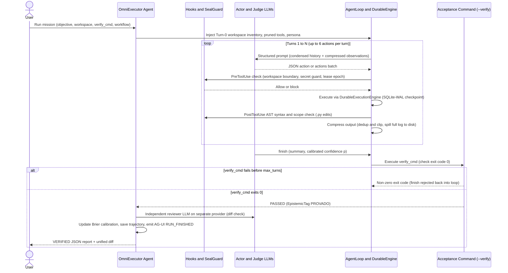

# OmniExecutor Agent

**An autonomous software engineering agent with a hierarchical team orchestrator, a self-healing CDP browser engine, closed-loop Windows desktop automation, and an MCP / A2A / AG-UI interoperability harness — built around durable execution, executable verification, and hard safety gates.**

[](tests/)
[](#benchmarks-and-honest-caveats)
[](#complete-cli-reference-all-21-subcommands)
[](SECURITY.md)
[](#protocol-integrations)
[](pyproject.toml)
[](LICENSE)

---

**Contents**

1. [Why OmniExecutor Agent Exists](#why-omniexecutor-agent-exists)
2. [Capability Overview](#capability-overview)
3. [Architecture & Mission Lifecycle](#architecture--mission-lifecycle)
4. [Quick Start & Environment Configuration](#quick-start--environment-configuration)
5. [Complete CLI Reference (All 21 Subcommands)](#complete-cli-reference-all-21-subcommands)
6. [Complete Agent Tool Catalog (All 32 Workspace Tools)](#complete-agent-tool-catalog-all-32-workspace-tools)
7. [Hierarchical Team Orchestration & Engineering Personas](#hierarchical-team-orchestration--engineering-personas)
8. [Protocol Integrations (MCP, A2A v0.3, Multi-Channel Gateway & AG-UI SSE)](#protocol-integrations)
9. [Built-in Security Analyzer & Deterministic Guardrails](#built-in-security-analyzer--deterministic-guardrails)
10. [Practical Playbooks Across Project Types](#practical-playbooks-across-project-types)
11. [Mathematical Foundations](#mathematical-foundations)
12. [Benchmarks and Honest Caveats](#benchmarks-and-honest-caveats)
13. [Known Limitations & Repository Layout](#known-limitations--repository-layout)
14. [Contributing & Security](#contributing--security)

---

## Why OmniExecutor Agent Exists

Most autonomous coding agents fail in predictable, mechanical ways: they edit files before reading them, rewrite entire modules to fix two lines, flood their context window with unpruned test logs, reload browser tabs and lose DOM state, or claim success without running an acceptance command.

OmniExecutor Agent treats every one of those failure modes as a systems-engineering invariant:

- **Results are verified, not declared.** A coding mission is marked `VERIFIED` only if your deterministic acceptance command (`--verify`, for example `python -m pytest -q`) exits with code `0`. Calling `finish` while the acceptance check still fails is rejected back into the loop with the failing tail so the agent fixes it before concluding.
- **Execution is durable.** Every workspace mutation, command, and UI action routes through `DurableExecutionEngine` (SQLite in WAL mode) with an explicit side-effect taxonomy (`pure_read`, `idempotent_write`, `compensatable_mutation`, `irreversible_external`) and lease-epoch fencing, preventing duplicated side effects or stale workers from writing after a timeout.
- **Context is engineered from Turn 0.** Before the model spends a single tool turn, OmniExecutor injects a filtered workspace inventory (and a PageRank symbol map on compact repositories), prunes irrelevant tool families (`browser_*`, `pc_*`, `spawn_*`) based on the objective, lets the agent batch up to **6 independent actions per turn**, and compresses noisy observations while spilling untruncated logs to disk.
- **Safety is enforced outside the prompt.** Deterministic pre/post-write AST hooks block hardcoded credentials and catch Python syntax errors before returning to the LLM, while `ConstitutionSealGuard` protects sealed configuration and evaluation zones with SHA-256 verification.
- **Failures escalate cleanly.** Optional `adaptive_best_of_n` automatically snapshots the workspace before attempt 1 and escalates on failure to specialist recovery roles (`sparc` + `tdd_enforcer`, `react` + `build_error_resolver`) fed by a structured failure post-mortem.

---

## Capability Overview

| Domain | What OmniExecutor Agent Can Do | Primary Module(s) |
| :--- | :--- | :--- |
| **Autonomous Coding Loop** | Native typed tool calling (`tools` / `tool_calls`) across OpenAI, Anthropic, Gemini Native, Groq, OpenRouter & Ollama with explicit `cache_control` prompt caching, extended thinking budgets, and SSE streamed tool assembly; parallel `ThreadPoolExecutor` dispatch for `PURE_READ` batches; dynamic first-class MCP tool mounting (`mcp__<server>__<tool>`); ReAct, SPARC (`S/P/A/R/C`), and Hierarchical DAG workflows; Turn-0 inventory + `AgentlessThreePhaseLocalizer`; live `grammar_json_repair`, `SimHashSemanticCache`, `prompt_token_pruner`, `OpenHandsStuckDetector`, `ShellSemanticPolicyRails`, and `AiderFuzzySearchReplaceEngine` cascade; `Plan`/`Act` gate | `cognition/llm_client.py`, `execution/agent_loop.py`, `execution/workspace_tools.py`, `execution/tool_schemas.py`, `execution/loop_policies.py`, `execution/openhands_organs.py`, `execution/apex_codeact_fuzzy.py` |
| **220 Deterministic Zero-Token Rails** | Sub-millisecond zero-token rails spanning `ast-grep`, `LibCST`, `Comby`, polyglot JS/TS/Rust/Go/clone detection, live host silicon CPU cache & DRAM bandwidth probing (`Win32_CacheMemory` / `sysfs`), `LLMLingua` token pruning, `Z3` SMT, `Hypothesis`, `ddmin`, `Ochiai` SBFL fault localization, `TLA+` TLC model checker, `Raft/Paxos` self-healing, Windows app/PATH/process discovery, Electron ASAR probing, BM25 full-text search, SQL/Pydantic schema inference, CRDT/VectorClocks/JWT/Merkle verification, and `fastmft`/Casimir radar | `execution/deterministic_offloader.py`, `execution/deterministic_matrix_100.py`, `execution/deterministic_matrix_v70.py`, `execution/token_latency_savers.py`, `execution/apex_fault_localizer.py`, `execution/tla_formal_verifier.py`, `execution/raft_paxos_healing.py`, `execution/cpu_cache_telemetry.py`, `execution/apex_v62_extracts.py` |
| **HyperFleet & Hierarchical Teams** | In-process `HyperFleet` executing **1,000+ concurrent agents** at **`0.173 KB` RAM/agent** with Go-style `SingleFlightCoalescer`, `begin_generation` zero-erasure chaining, hard USD budget gate, `ResourceLockManager` (`FIFOLock`), plus severity-scored (`0–10`) Dev Squad / Executive Fleet waves | `execution/subagent_bus.py`, `execution/openhands_organs.py`, `cognition/personas.py` |
| **Code Intelligence** | Polyglot AST/parser symbol map ranked with weighted PageRank (`Python`, `JS/TS`, `Rust`, `Go`); vectorless Merkle-tree index (`sync_incremental`) with ACL/RBAC scoping & Mermaid graph export; persistent stdio LSP client | `perception/polyglot_repomap.py`, `perception/knowledge_index.py`, `perception/lsp_client.py`, `perception/silicon_radar.py` |
| **Browser Automation** | Isolated Chromium via Playwright/CDP with `[1..N]` indexed interactive elements, self-healing multi-strategy locators, payment/checkout hard-stop guard (`block_on_payment`), same-URL idempotence, and SSRF-guarded `web_fetch` | `gui/cdp_browser.py`, `gui/verified_browser_adapter.py` |
| **Desktop Automation (Windows)** | Closed-loop Win32 UI Automation + Set-of-Mark visual tagging + OCR + window/process/port/clipboard control protected by a process-wide exclusive GUI lock | `execution/pc_automation.py` |
| **Skill Self-Extension** | Runtime Python skill creation gated by an AST sandbox, symlink rejection, and SHA-256 verification, plus one-call wrapping of external CLI binaries into typed JSON skills | `execution/adaptive_skills.py` |
| **Protocol Federation** | Built-in MCP server (`mcp-serve`) & client hub; A2A v0.3 JSON-RPC 2.0 router; burst-debounced multi-channel ingress gateway; zero-dependency loopback AG-UI SSE streamer; [`llms.txt`](llms.txt) repository index | `execution/mcp_federation.py`, `execution/subagent_bus.py`, `cognition/agui_protocol.py` |
| **Security & Governance** | SHA-256 seal guard; 15-rule `shield` SAST scanner; pipe-aware 5-class command gate (`READ..DESTRUCTIVE`); symlink escape guard; host-pinned memory namespaces (`TriadMemoryProvider.scoped`); DPAPI envelopes; RAM/disk homeostasis | `governance/`, `security/`, `execution/hook_engine.py`, `memory/triad_provider.py` |
| **Memory, Calibration & Evolution** | Three-layer memory; episodic trajectory replay; domain Brier-score calibration (`REQUIRE_DOUBLE_CHECK` / `CAUTIOUS_VERIFY` / `FULL_AUTONOMY`); UCB1 + Pareto-gated evolution | `memory/`, `cognition/reasoning_bank.py`, `contracts/calibration.py`, `evolution/` |

---

## Architecture & Mission Lifecycle

### System Architecture

```mermaid
flowchart TB
    subgraph Entry["Entry Points and External Protocols"]
        CLI["CLI: omni-executor.cmd (14 commands)"]
        PY["Python API: OmniExecutorAgent"]
        MCP["MCP Server / Client Hub (JSON-RPC 2.0 stdio)"]
        A2A["A2A v0.3 Router and Multi-Channel Gateway"]
        AGUI["AG-UI Live Stream (127.0.0.1 SSE)"]
    end

    subgraph Gov["Governance and Security"]
        SEAL["ConstitutionSealGuard (SHA-256 manifest)"]
        SHIELD["AgentShieldAuditor (15 static and SAST rules)"]
        HOOKS["DeterministicHookEngine (Pre-write secret guard + Post-edit AST)"]
        HOMEO["HomeostasisGovernor (RAM, disk, token, stagnation caps)"]
    end

    subgraph Cog["Cognition, Memory and Perception"]
        LLM["LLMClient (failover chain + circuit breaker + independent judge)"]
        PERSONA["PersonaManager (10 engineering roles)"]
        REPOMAP["PolyglotRepoMapper (AST + weighted PageRank)"]
        KGRAPH["HierarchicalKnowledgeIndex (SHA-256 delta sync + Mermaid)"]
        BANK["ReasoningBank + Brier Calibration"]
    end

    subgraph Exec["Durable Execution Engines"]
        DURABLE["DurableExecutionEngine (SQLite-WAL + EffectClass + LeaseFencer)"]
        AGENT_LOOP["AgentLoop (ReAct / SPARC / Hierarchical + 6x batching)"]
        COMPRESS["ToolOutputCompressor (+ disk spill log)"]
        TEAM["SubAgentSessionBus (wave orchestrator + GUI lock)"]
        BROWSER["CDPIndexedBrowser (self-healing indexed DOM)"]
        DESKTOP["PCAutomationEngine (Win32 UIA + SoM + OCR)"]
        SKILLS["AdaptiveSkillForge (AST gate + SHA-256 skills + CLI wrappers)"]
    end

    Entry --> Gov --> Cog --> Exec
```



### End-to-End Mission Sequence



---

## Quick Start & Environment Configuration

> **Platform note.** Core coding, repository indexing, MCP/A2A protocols, and CDP browser automation run in standard Python 3.11+, while desktop automation (`pc`), isolated Win32 desktops, DPAPI envelopes, and default shell commands (`pwsh`) are currently **Windows-first**. Configure a writable `safe_temp_root` in `constitution/IMMUTABLE_CONSTITUTION.json` if needed. See [Known Limitations](#known-limitations--repository-layout).

### 1. Clone and install

```powershell
git clone https://github.com/juan3861/omni-executor.git
cd omni-executor
pip install -e .

# Optional extras — install only for the organs you plan to use:
pip install playwright pytesseract pillow numpy uiautomation
playwright install chromium
```

### 2. Configure providers & runtime environment

The multi-provider `LLMClient` automatically checks configured endpoints in order, fails over on HTTP `408/409/425/429/5xx` or timeouts, and maintains a per-provider circuit breaker (cooldown `25s` after `3` failures).

```powershell
$env:GROQ_API_KEY       = "<your-groq-key>"
$env:OPENROUTER_API_KEY = "<your-openrouter-key>"
# Optional overrides:
# $env:OPENAI_API_KEY   = "<your-openai-key>"
# $env:AM_UA_PROVIDERS  = "groq,openrouter,openai"
```

| Environment Variable | Purpose | Default Value / Example |
| :--- | :--- | :--- |
| `AM_UA_PROVIDERS` | Comma-separated failover order for LLM providers | `omniroute,groq,openrouter,openai` |
| `GROQ_API_KEY` | API key for Groq OpenAI-compatible inference | Required if `groq` is in chain |
| `AM_UA_GROQ_MODEL` | Override default Groq model | `openai/gpt-oss-120b` (fallbacks: `qwen/qwen3.8-27b`, `openai/gpt-oss-20b`) |
| `OPENROUTER_API_KEY` | API key for OpenRouter inference | Required if `openrouter` is in chain |
| `AM_UA_OPENROUTER_MODEL` | Override default OpenRouter model | `cohere/north-mini-code:free` (fallback: `nvidia/nemotron-3.5-lightning:free`) |
| `OPENAI_API_KEY` | API key for OpenAI inference | Required if `openai` is in chain |
| `AM_UA_OPENAI_MODEL` | Override default OpenAI model | `gpt-5-mini` |
| `E2B_API_KEY` | Optional E2B cloud microVM sandbox key | Unset (falls back cleanly to local mode) |
| `EXA_API_KEY` | Optional Exa search API key | Unset (uses local/CDP web tools) |
| `AM_UA_KEEP_CURRENT_DESKTOP` | Set `"1"` to disable isolated Win32 desktop creation during GUI automation | Unset (`0`) |

### 3. Run baseline health checks

```powershell
.\omni-executor.cmd doctor     # Multi-organ readiness, SHA-256 seal, SQLite-WAL & host headroom
.\omni-executor.cmd shield .   # Built-in static analysis (secrets, MCP configs, hooks, SAST)
pytest tests -q                # Full automated suite (105 unit & integration tests)
```

---

## Complete CLI Reference (All 21 Subcommands)

Every capability is accessible through `.\omni-executor.cmd <command> [args]` (or `python -m am_ua.cli <command>`).

| Command | Summary | Key Options & Arguments |
| :--- | :--- | :--- |
| **`doctor`** | Full readiness audit: single state owner, constitutional SHA-256 seal, topology compliance, memory layers, and host RAM/disk headroom | None (`exit 0` if healthy and topology valid) |
| **`shield`** | Static security scanner covering secrets, MCP configs, hook injection, dangerous permissions, and unsafe code sinks | `[target]` (default repo root); prints JSON score + grade `A`–`F` |
| **`det`** | Programmable Deterministic Command Hub: list or invoke any of the **220 zero-token deterministic rails** (`ast_syntax_sweep`, `sbfl_ochiai_fault_localize`, `tla_bounded_model_checker`, `raft_partition_self_healer`, `live_silicon_cpu_cache_probe`, `bm25_workspace_fulltext_search`, `electron_asar_manifest_probe`, `v70_omega_220_full_spectrum_gate`, etc.) | `list\|run` `[rail]` `--workspace DIR` `--params JSON` |
| **`fleet`** | Launch `HyperFleet` high-density in-process concurrent agent swarm (`1,000+` agents at `<1 KB` RAM/agent, `SingleFlight` coalescing & USD cap) | `--count N` `--max-usd FLOAT` `--concurrency N` `--objective TEXT` `--workspace DIR` |
| **`swebench`** | Official SWE-bench instance/prediction validation & deterministic evaluation harness | `validate-predictions` `--predictions PATH` `--workspace DIR` |
| **`lsp`** | Query `PersistentLSPClient` diagnostics or symbol `goto_definition` (JSON-RPC 2.0 stdio with instant Python AST fallback) | `diagnostics\|definition` `<target>` `--workspace DIR` `--language LANG` |
| **`daemon`** | Interact with the crash-safe SQLite-WAL `DurableDaemonQueue` for always-on queued tasks & webhooks | `enqueue\|stats\|claim` `--objective TEXT` `--workspace DIR` `--priority N` `--worker-id ID` `--db PATH` |
| **`a2a-serve`** | Serve `GET /.well-known/agent.json` AgentCard and `POST /a2a` (`tasks/send`, `tasks/get`, `tasks/cancel`) or print AgentCard | `--host HOST` `--port PORT` `--auth-token TOK` `--card-only` |
| **`mission`** | Run the autonomous coding/browser/desktop agent on a workspace | `<objective>` `--workspace DIR` `--verify CMD` `--max-turns 30` `--provider P` `--role ROLE` `--workflow react\|sparc\|hierarchical` `--best-of-n N` `--wheel-timeout SEC` `--agui-port PORT` `--mission-id ID` `--full-json` |
| **`repomap`** | Generate a PageRank-weighted symbol summary across `.py`, `.js/.ts`, `.rs`, and `.go` files | `[target]` (default `src`) `--max-chars 3000` |
| **`radar`** | Run topological structural scan and UCIP module summary | `[target]` (default `src`) |
| **`browser`** | Drive the self-healing `[1..N]` indexed Playwright/CDP browser | `observe\|act\|extract` `--url URL` `--index N` `--selector CSS` `--act-type click\|fill\|press` `--value TEXT` |
| **`pc`** | Execute closed-loop Windows desktop primitives and locators | `probe\|windows\|observe\|find\|clipboard\|processes\|port` `--locator L` `--filter F` `--text T` `--port N` `--no-ocr` |
| **`skills`** | Inspect, search, and invoke SHA-256 sealed adaptive Python skills | `list\|search\|run` `--query Q` `--name N` `--kwargs '{"k":"v"}'` |
| **`mcp-serve`** | Start the standards-compliant JSON-RPC 2.0 MCP server over `stdio` | None |
| **`acp-serve`** | Start the Agent Client Protocol (ACP) JSON-RPC 2.0 server over `stdio` (`initialize`, `session/new`, `session/prompt`, `session/cancel`) | None |
| **`bench`** | Execute or summarize the sealed real-LLM evaluation suite (`eval/am_bench`) | `run\|report` `--suite code\|desktop\|all\|quick` `--workflow react\|sparc\|hierarchical` `--max-turns 12` `--label TAG` |
| **`wheel`** | Inspect or control missions paused for "Take the Wheel" human intervention | `status\|resume\|abort` `[mission_id]` `--note TEXT` |
| **`ingest-doc`** | Parse `.docx`, `.xlsx`, `.csv`, `.pdf`, or `.md` with R16 external taint tracking into semantic memory | `<file_path>` |
| **`handoff`** | Export a portable `HANDOFF_PACK` snapshot for cold-session team handoffs | `--out DIR` (default `HANDOFF_PACK`) |
| **`pipeline`** | Execute the deterministic multi-organ diagnostic pipeline without an LLM loop | `<objective>` `--mission-id ID` `--domain D` `--scan-dir DIR` `--repomap-dir DIR` `--ingest-doc FILE` `--force-dag` |

### Common CLI Examples

```powershell
# 1. Autonomous bug-fix with SPARC discipline + real-time AG-UI event streaming
.\omni-executor.cmd mission "Fix the integer overflow in billing.py and add boundary checks" `
    --workspace .\sandbox\billing_app `
    --verify "python -m pytest -q" `
    --workflow sparc --role tdd_enforcer --agui-port 8765

# 2. Generate a compact symbol overview of any codebase before onboarding
.\omni-executor.cmd repomap .\src --max-chars 4000

# 3. Inspect which Windows process owns a congested port or capture UIA/OCR elements
.\omni-executor.cmd pc port --port 8080
.\omni-executor.cmd pc observe --locator "name:Save"

# 4. Run a headless indexed browser observation or extract clean DOM text
.\omni-executor.cmd browser observe --url "https://example.com"
.\omni-executor.cmd browser extract --url "https://example.com" --selector "main"

# 5. Pause & resume via "Take the Wheel" from a second terminal
.\omni-executor.cmd wheel status
.\omni-executor.cmd wheel resume agent-1794940001-a1b2c3 --note "2FA approved; continue deployment check"
```

---

## Complete Agent Tool Catalog (All 32 Workspace Tools)

Inside `AgentLoop`, every action is validated against workspace boundaries, constitutional rules, and pre/post AST hooks. The system advertises only relevant tool groups to save tokens, and supports single calls (`{"tool": ..., "args": ...}`) or **batched execution of up to 6 actions per turn** (`{"actions": [...]}`).

### Filesystem & Surgical Editing

| Tool | Effect Class | Required / Key Arguments | Behavior |
| :--- | :--- | :--- | :--- |
| `list_dir` | `pure_read` | `path` (default `"."`), `depth` (max `4`) | Walks workspace safely (skipping `.git`, `node_modules`, `__pycache__`, `.venv`), capped at 400 entries |
| `read_file` | `pure_read` | `file`, optional `start_line`, `end_line` | Reads line-numbered slices (up to 400 lines per call, clipped cleanly) |
| `search` | `pure_read` | `pattern` (Python regex), optional `path` | Searches non-binary workspace files under 1 MB; returns up to 200 `file:line: snippet` hits |
| `write_file` | `compensatable_mutation` | `file`, `content` | Strips accidental markdown fences, checks secrets pre-write, runs Python AST check post-write |
| `replace_in_file` | `compensatable_mutation` | `file`, `old`/`new` or `hunks` | Enforces exact single-match replacement (`count == 1`), or applies multiple `hunks` atomically in memory (all-or-nothing rollback on mismatch) |

### Execution, Checkpointing & Verification

| Tool | Effect Class | Required / Key Arguments | Behavior |
| :--- | :--- | :--- | :--- |
| `run` | `compensatable_mutation` | `command`, optional `timeout_s` (max `600`) | Runs PowerShell (`pwsh -NoProfile -NonInteractive`) inside the scrubbed workspace environment; denylists destructive patterns (`format`, `diskpart`, `shutdown`, `git push`, etc.) |
| `checkpoint` | `pure_read` | optional `name` (default `"default"`) | Captures in-memory SHA-tagged snapshot of workspace files (<= 512 KB each) before risky edits |
| `restore_checkpoint` | `compensatable_mutation` | optional `name` | Atomically restores all files captured in the named snapshot after seal verification |

### Code Intelligence & Knowledge Discovery

| Tool | Effect Class | Key Arguments | Behavior |
| :--- | :--- | :--- | :--- |
| `repo_map` | `pure_read` | `max_chars` (default `3000`, max `12000`) | Returns top PageRank-ranked files, symbol counts, and compact structural summary |
| `knowledge_query` | `pure_read` | `question`, `top_k` (max `15`) | Queries `HierarchicalKnowledgeIndex` over docs, SQL schemas, configs, and source without external vector DBs |
| `task_tracker` | `idempotent_write` | `command` (`view`\|`plan`), `task_list` | Tracks structured subtasks (`todo`, `in_progress`, `done`) with alias normalization and live AG-UI `STATE_DELTA` updates |
| `web_fetch` | `pure_read` | `url`, `max_chars` (max `20000`) | Lightweight HTML-to-Markdown reader with DNS/IP SSRF guard (blocks loopback, RFC1918, `169.254.0.0/16`, IPv4-mapped IPv6) and `UNTRUSTED_EXTERNAL` taint tagging |
| `spill_query` | `pure_read` | `spill_path`, optional `pattern`, `start_line`, `max_lines` | Searches or slices large spilled tool outputs saved on disk by `ToolOutputCompressor` |
| `code_sandbox` | `pure_read` | `code` | In-memory restricted AST evaluator (~1 ms) for deterministic math, JSON, and assertions without spawning a shell |

### Self-Healing CDP Browser Automation

| Tool | Effect Class | Key Arguments | Behavior |
| :--- | :--- | :--- | :--- |
| `browser_observe` | `pure_read` | optional `url`, `headless`, `wait_ms`, `force_reload` | Launches isolated headless/headed Chromium via CDP, indexes interactive controls `[1..N]`; skips reload when already on `url` |
| `browser_act` | `compensatable_mutation` | `action` (`click`\|`fill`\|`goto`\|`press`), `idx` / `target`, `text`, `url` | Executes element interaction by integer `[idx]` or text/semantic fallback if CSS selectors break |
| `browser_extract` | `pure_read` | optional `selector` (default `"body"`) | Extracts visible DOM text and structured fields safely |

### Closed-Loop Windows Desktop RPA

| Tool | Effect Class | Key Arguments | Behavior |
| :--- | :--- | :--- | :--- |
| `pc_observe` | `pure_read` | `include_ocr`, `max_elements` (max `120`), `window_title`, `hwnd` | Captures Set-of-Mark screenshot + Win32 UI Automation elements + OCR boxes + 2048-bit visual dHash |
| `pc_ground_vlm` | `pure_read` | `target`, optional `window_title`, `refresh` | Uses multimodal VLM visual grounding on Set-of-Mark overlays to locate unlabeled controls |
| `pc_act` | `compensatable_mutation` | `action_type` (`click`\|`double_click`\|`right_click`\|`type`\|`hotkey`\|`press`\|`scroll`\|`move`), `tag_id` / `target` / coords, `text`, `keys`, `dry_run` | Executes closed-loop physical action guarded by prior observation and the exclusive GUI lock |
| `pc_window` | `compensatable_mutation` | `action` (`list`\|`active`\|`find`\|`focus`\|`minimize`\|`maximize`\|`restore`\|`move_resize`\|`launch`\|`close`\|`cleanup`), `locator`, `app_cmd`, `rect` | Manages top-level windows, launches isolated test apps cleanly, and cleans up spawned test windows |
| `pc_clipboard` | `idempotent_write` | `action` (`get`\|`set`), `text` | Reads or sets host clipboard text safely |
| `pc_process` | `pure_read` | `action` (`list`\|`port_owner`), `filter`, `port` | Lists host processes or identifies the exact PID holding a TCP port |

### Multi-Agent Teams, Dynamic Skills & MCP

| Tool | Effect Class | Key Arguments | Behavior |
| :--- | :--- | :--- | :--- |
| `spawn_agent` | `compensatable_mutation` | `objective`, optional `role`, `wait`, `parent_id`, `current_depth` | Spawns an isolated worker session in the SQLite-WAL `SubAgentSessionBus` (capped at depth `2`) |
| `spawn_team` | `compensatable_mutation` | `objective`, optional `workspace_file_count` | Evaluates complexity score (`0–10`) and orchestrates waves from solo agent up to a 9-agent executive fleet |
| `send_agent` | `idempotent_write` | `recipient_id`, `content`, optional `sender_id` | Sends typed cross-agent coordination messages over the persistent message bus |
| `await_agents` | `pure_read` | `session_ids`, optional `timeout_s` | Awaits completion of child agent sessions and gathers structured summaries |
| `skill_forge` | `idempotent_write` | `name`, `description`, `code`, optional `tags`, `test_kwargs` | Parses Python AST through security gate, executes self-test, computes SHA-256 digest, and persists skill |
| `skill_run` | `compensatable_mutation` | `action` (`run`\|`list`\|`search`), `name`, `kwargs`, `query` | Re-verifies SHA-256 hash before invoking any stored adaptive skill |
| `mcp_call` | `compensatable_mutation` | `action` (`call`\|`list`), `server`, `tool`, `arguments` | Discovers and invokes tools hosted by external MCP JSON-RPC 2.0 `stdio` servers |

### Human-in-the-Loop & Mission Completion

| Tool | Mechanism | Key Arguments | Behavior |
| :--- | :--- | :--- | :--- |
| `handoff_agent` | Loop control (`AgentLoop`) | `target_role`, optional `reason`, `context_note` | Dynamically transfers control to a specialist role mid-mission, re-composes scoped system prompt/persona, and emits `AGENT_HANDOFF` AG-UI event |
| `request_human` | Loop gate (`HumanWheelGate`) | `reason`, `instructions` | Pauses mission for "Take the Wheel" operator action (up to 3 times/mission), credits paused time out of the wall-clock budget, and emits AG-UI custom event |
| `finish` | Terminal verification oracle | `summary`, `confidence` (`[0.0, 1.0]`) | Triggers `--verify` command immediately if not yet satisfied; rejects `finish` with error output if `--verify` exits non-zero; otherwise computes Brier score & triggers independent judge |

---

## Hierarchical Team Orchestration & Engineering Personas

`SubAgentSessionBus` avoids both under-staffed single-agent bottlenecks and runaway fork bombs by scoring every objective from `0` to `10` (`assess_team_topology`) across four orthogonal signals: matched engineering domains (`architecture`, `backend_code`, `frontend_browser`, `security`, `performance`, `testing_qa`), workspace file scope, critical/production severity markers, and explicit multi-agent intent.

| Severity Score | Topology Mode | Agents Spawned | Wave Execution Plan & Leadership Chain |
| :---: | :--- | :---: | :--- |
| **`0–2`** | `solo_specialist` | **1** | Wave 1: `general_engineer` |
| **`3–5`** | `dev_squad` | **4** | Wave 1: `systems_architect` → Wave 2: `general_engineer` → Wave 3: `eng_supervisor` + `tdd_enforcer` |
| **`6–10`** | `executive_enterprise_fleet` | **9** | Wave 1: `product_ceo` + `systems_architect` → Wave 2: `general_engineer` + `build_error_resolver` + `performance_sre` → Wave 3: `eng_supervisor` + `security_auditor` → Wave 4: `tdd_enforcer` + `strict_auditor` |

**Hard Guardrails (Enforced in `subagent_bus.py`):**
- **RAM-aware parallel worker cap (`2–8`):** Automatically expands or contracts concurrency based on live free host RAM above a `2560 MB` floor (never crashing smaller machines or saturating servers).
- **Hard ceiling of `16` agents per mission** and **maximum spawn depth of `2`** (`SubAgentDepthExceededError`).
- **Process-wide Exclusive GUI Lock (`acquire_gui_exclusive_lock`):** Even when 8 background workers run concurrently, at most **one** worker may hold physical mouse/keyboard focus at a time.
- **Wave Context Handoff:** Each wave receives the compressed summaries of upstream waves so architectural contracts propagate down to implementers and diffs propagate up to supervisors and auditors.

### All 10 Specialist Engineering Personas

Use `--role <role>` on the CLI (or pass `--role auto` to auto-select by task keywords). Contracts for coding/audit roles live as Markdown-as-Code in `constitution/personas/`, while executive/coordination contracts are built into `PersonaManager`.

| Role Identifier (Aliases) | Title | Core Operational Contract |
| :--- | :--- | :--- |
| `product_ceo` (`ceo`) | Executive Product CEO | Locks high-leverage acceptance criteria, cuts scope bloat, aligns squads on user ROI |
| `systems_architect` (`architect`) | Principal Systems Architect | Maps module topology, enforces clean interface boundaries, prevents circular dependencies |
| `eng_supervisor` (`supervisor`, `lead`) | Engineering Supervisor & Tech Lead | Coordinates parallel developer diffs, maintains repository hygiene, blocks unverified handoffs |
| `general_engineer` (`general`, `coder`) | General Senior Engineer | Reads before writing, applies minimal surgical edits, verifies empirically |
| `tdd_enforcer` (`tdd`) | Red-Green TDD Enforcer | Requires failing reproduction before edits, probes empty/boundary/malformed inputs |
| `security_auditor` (`security`) | Principal Security & SAST Auditor | Audits secrets, command injection, unsafe deserialization, SSRF, and constitutional boundaries |
| `security_reverse_engineer` (`reverse_engineer`) | Reverse Engineering & Security Specialist | Deep binary/protocol analysis, taint slicing, vulnerability verification |
| `build_error_resolver` (`build`) | Compiler & Build Error Resolver | Pinpoints syntax, import, type, and dependency breaks with minimal blast radius |
| `performance_sre` (`sre`, `perf`) | Performance & Low-Latency SRE | Eliminates algorithmic complexity, redundant I/O, and memory pressure |
| `strict_auditor` (`auditor`) | Strict Empirical Auditor | Enforces triple-proof verification (logical, physical, visual/output); rejects stubs and mocks |

---

## Protocol Integrations

### 1. Model Context Protocol (MCP Server & Federation Client)

Plug OmniExecutor Agent directly into **Claude Code, Cursor, Codex CLI, or Antigravity** by adding `.mcp.json` to your project:

```json
{
  "mcpServers": {
    "omni-executor": {
      "command": "cmd",
      "args": ["/c", "C:\\path\\to\\omni-executor\\omni-executor.cmd", "mcp-serve"]
    }
  }
}
```

Or run outbound calls from OmniExecutor to any external MCP `stdio` server using `MCPFederationHub` / the `mcp_call` tool. When launched via `mcp-serve` (with `AgentShieldAuditor` attached), the server exposes **7 MCP tools** (`6` core desktop/skill tools always registered, plus `am_security_shield`, with `serverInfo.name = "omni-executor-mcp"`):

| MCP Tool Name | Description | Arguments |
| :--- | :--- | :--- |
| `am_pc_probe` | Probes host screen geometry, active window, OCR availability, and protected zones | None |
| `am_security_shield` | Runs the static security audit across a directory and returns grade + findings | `path` |
| `am_pc_windows` | Lists visible Windows top-level windows with `hwnd`, PID, and executable | `title_filter` |
| `am_pc_observe` | Captures Set-of-Mark desktop observation (UIA + OCR + 2048-bit visual dHash) | `window_title`, `include_ocr` |
| `am_skill_list` | Lists all AST-validated, SHA-256 sealed Python skills | None |
| `am_skill_forge` | Forges, AST-audits, tests, and seals a new reusable Python skill | `name`, `code`, optional `description` |
| `am_skill_run` | Verifies SHA-256 digest and executes a registered skill | `name`, `kwargs` |

### 2. Agent2Agent (A2A v0.3) JSON-RPC 2.0 & Multi-Channel Gateway

Expose OmniExecutor Agent as an A2A v0.3 agent (`agent/card`, `tasks/send`, `tasks/get`, `tasks/cancel`) or ingest normalized messages from Slack, WhatsApp, Discord, Telegram, Teams, webhooks, or CLI:

```python
from am_ua.execution.subagent_bus import SubAgentSessionBus
from am_ua import OmniExecutorAgent

agent = OmniExecutorAgent()
bus = SubAgentSessionBus()

def real_worker(sid, obj, ws):
    return agent.run_agent_mission(obj, workspace=ws, verify_cmd="python -m pytest -q")

# 1. Discover Agent Card (A2A v0.3)
card = bus.handle_a2a_rpc({"jsonrpc": "2.0", "id": "1", "method": "agent/card"})
print(card["result"]["name"], card["result"]["protocolVersion"])  # OmniExecutor Agent 0.3.0

# 2. Submit and poll an A2A task
queued = bus.handle_a2a_rpc(
    {"jsonrpc": "2.0", "id": "2", "method": "tasks/send", "params": {"objective": "Audit utils.py", "role": "security_auditor", "wait": True}},
    executor_fn=real_worker,
)
status = bus.handle_a2a_rpc({"jsonrpc": "2.0", "id": "3", "method": "tasks/get", "params": {"id": queued["result"]["id"]}})

# 3. Normalize chat/webhook events into A2A tasks (with optional burst debouncing)
bus.ingest_channel_event({"channel": "telegram", "sender": "alice", "text": "Fix bug in parser.py"}, debounce_window_s=2.0)
bus.ingest_channel_event({"channel": "telegram", "sender": "alice", "text": "Also add edge case tests"}, debounce_window_s=2.0)
flushed = bus.flush_channel_debounce(channel="telegram", sender="alice", executor_fn=real_worker)
print(flushed[0]["coalesced_count"], flushed[0]["turn_id"])  # 2, turn-...
```

### 3. Live AG-UI Event Stream (Loopback Server-Sent Events)

Pass `--agui-port 8765` to `omni-executor.cmd mission ...` (or pass `agui_port=8765` in Python) to stream structured, finite-number-validated, secret-redacted Server-Sent Events on `http://127.0.0.1:8765/events` while simultaneously writing a durable `fsync`-backed JSONL ledger:

- **Emitted Event Types (13):** `RUN_STARTED`, `RUN_FINISHED`, `RUN_ERROR`, `STEP_STARTED`, `STEP_FINISHED`, `TEXT_MESSAGE_CONTENT`, `TOOL_CALL_START`, `TOOL_CALL_ARGS`, `TOOL_CALL_END`, `TOOL_CALL_RESULT`, `STATE_SNAPSHOT`, `STATE_DELTA`, `CUSTOM`.
- Any key matching `(KEY|TOKEN|SECRET|PASSWORD|PASSWD|CREDENTIAL|AUTH)` is automatically replaced with `[REDACTED_SECRET]` before hitting logs or SSE subscribers.

---

## Built-in Security Analyzer & Deterministic Guardrails

Running `.\omni-executor.cmd shield .` (or `AgentShieldAuditor().scan_directory(path, include_source_sast=True)`) evaluates **15 deterministic rules**, computes a weighted risk score (`CRITICAL=30`, `HIGH=15`, `MEDIUM=5`, `LOW=1`), and grades the project `A` (`0`) through `F` (`>60`):

| Rule ID | Severity | Category | What It Detects |
| :--- | :--- | :--- | :--- |
| `SHIELD-SEC-001` | CRITICAL | `secret` | Hardcoded OpenAI-style key tokens |
| `SHIELD-SEC-002` | CRITICAL | `secret` | Hardcoded Groq-style key tokens |
| `SHIELD-SEC-003` | CRITICAL | `secret` | Hardcoded GitHub classic personal access tokens |
| `SHIELD-SEC-004` | CRITICAL | `secret` | Hardcoded Google API key tokens |
| `SHIELD-SEC-005` | HIGH | `secret` | Hardcoded literal assignments to `api_key`, `secret_key`, `auth_token`, or `password` |
| `SHIELD-MCP-001` | MEDIUM | `mcp` | Unpinned `npx` MCP server packages without an explicit `@version` pin |
| `SHIELD-MCP-002` | HIGH | `mcp` | Remote non-loopback MCP server URLs using plain unencrypted HTTP instead of HTTPS |
| `SHIELD-HOOK-001` | CRITICAL | `hook_injection` | Remote download commands (`curl`/`wget`/`irm`) piped directly into a shell interpreter |
| `SHIELD-HOOK-002` | HIGH | `hook_injection` | Dynamic shell evaluation expressions or git hook bypass flags in manifests/configs |
| `SHIELD-PERM-001` | HIGH | `permission` | Manifest flags enabling dangerous permission or verification-seal bypasses |
| `SHIELD-SAST-001` | HIGH | `sast` | Unsafe binary deserialization (`pickle.load` / `pickle.loads`, **CWE-502**) |
| `SHIELD-SAST-002` | HIGH | `sast` | YAML deserialization (`yaml.load`) without `SafeLoader` (**CWE-502**) |
| `SHIELD-SAST-003` | MEDIUM | `sast` | Explicit TLS certificate validation bypass (`verify=False`, **CWE-295**) |
| `SHIELD-SAST-004` | HIGH | `sast` | Process spawning (`subprocess.*`) with shell invocation enabled (**CWE-78**) |
| `SHIELD-SAST-005` | HIGH | `sast` | Arbitrary code evaluation primitives (**CWE-95**) in `.py`/`.js`/`.ts` files |

### Pipe-Aware Command Classifier & Runtime Isolation Guardrails

- **Pipe-aware fail-closed command gating & policy rails (`hook_engine.py`):** Shell commands passed to `run` strip quoted heredocs/here-strings (`<< 'EOF'`, `@' ... '@`) as inert data, split quote-safely across `|`, `&&`, `||`, `;`, classify every segment (`READ` $\rightarrow$ `WRITE` $\rightarrow$ `NETWORK` $\rightarrow$ `INSTALL` $\rightarrow$ `DESTRUCTIVE`), upgrade `NETWORK -> shell interpreter` pipes to `DESTRUCTIVE`, and fail closed to `WRITE` for unknown binaries. Structural `POLICY_RAILS` (`fetch-to-exec`, `raw-disk-op`, `catastrophic-delete`) and opaque subshell detection (`$(...)`, backticks, `& $var` escalating to `PROMPT` / `UNKNOWN`) feed worst-case fusion in `evaluate_ensemble_risk`.
- **Deterministic Test-Tamper Guard & `DeterministicPreCritic`:** `pre_write_test_tamper_guard` blocks edits to read-only verification specifications (`tests_visible/*`, `.agents/skills/verify-*`), while `AgentLoop.evaluate_pre_critic()` scores patch non-emptiness (`EmptyPatch`), finish discipline, and verification outcome before optional LLM review.
- **Browser Payment Hard-Stop (`cdp_browser.py`):** `CDPIndexedBrowser(block_on_payment=True)` inspects target DOM elements and labels prior to clicks/submissions, halting automatically before checkout or payment actions (`blocked_by_payment_guard=True`, `requires_human_approval=True`).
- **Symlink Traversal & Host-Pinned Memory Isolation:** `WorkspaceTools.resolve()` and `AdaptiveSkillForge` reject symlink traversal inside workspaces and skill bundles; `TriadMemoryProvider.scoped(namespace)` pins tenant namespaces strictly on the host side so LLM tool arguments cannot cross memory scopes.
- **Role Tool Scopes, Turn-0 Toolchain Markers & Tombstone Condensation (`agent_loop.py`):** `ROLE_TOOL_SCOPES` strips non-essential write/GUI tools on read-only/coordinator personas (`strict_auditor`, `security_auditor`, `product_ceo`, `systems_architect`), `rank_tools_for_objective` applies `FamilyThenDecide` / `RetrieveThenDecide` Softmax filtering ($p_{\min} = 0.05$), Turn 0 injects `TOOLCHAIN HINTS` from lockfiles (`uv.lock`, `pnpm-lock.yaml`, `Cargo.toml`, `go.mod`), and `_condense()` uses cache-friendly half-window `[CONDENSATION_TOMBSTONE]` compaction.
- **Background ToM Consolidation (`reasoning_bank.py`):** `sleeptime_consolidate()` and `consult_tom()` distill recurring workflows, top tools, and failure pitfalls into `tom_user_model.json`.

---

## Practical Playbooks Across Project Types

### 1. Autonomous Bug-Fixing & TDD in Python / Node / Rust / Go Repositories

```python
from am_ua import OmniExecutorAgent

agent = OmniExecutorAgent()
result = agent.run_agent_mission(
    "Rename calc_total to compute_total in every module and update all imports and tests",
    workspace="sandbox/my_app",          # must stay inside project dir or safe_temp_root
    verify_cmd="python -m pytest -q",    # exit code 0 == VERIFIED
    workflow="hierarchical",             # react | sparc | hierarchical
    role="auto",                         # automatically selects tdd_enforcer / build_error_resolver / security_auditor
    adaptive_best_of_n=2,                # snapshots workspace; escalates with failure post-mortem on attempt 1 failure
)
print(result["status"], result["turns"], result["changed_files"])
```

### 2. Multi-Agent Hierarchical Feature Delivery

```python
from am_ua import OmniExecutorAgent
from am_ua.execution.subagent_bus import SubAgentSessionBus

agent = OmniExecutorAgent()
bus = SubAgentSessionBus()

plan = bus.assess_team_topology(
    "Severe enterprise refactor: backend API, web dashboard, security audit, latency tuning, TDD",
    workspace_file_count=18,
)
print(plan["mode"], plan["severity_score"], plan["hierarchy"])

def run_member(session_id, role_objective, workspace_path):
    return agent.run_agent_mission(role_objective, workspace=workspace_path, max_turns=12)

# Pass worker_fn=run_member for real execution across all waves;
# omitting worker_fn runs in dry-run stub mode (records role objectives without LLM calls).
report = bus.orchestrate_team(
    "Implement JWT auth with replay protection and edge-case tests",
    worker_fn=run_member,
    workspace_file_count=18,
)
print(report["total_agents_spawned"], "agents in", report["waves_executed"], "waves")
```

### 3. Monorepo Indexing, Delta Sync & Living Mermaid Diagrams

```python
from am_ua.perception.knowledge_index import HierarchicalKnowledgeIndex

idx = HierarchicalKnowledgeIndex("path/to/repo")
print(idx.query("session table and authentication")["hits"])
print(idx.sync_changes())           # incremental re-index after edits using SHA-256 delta
print(idx.export_mermaid_graph())   # paste straight into any GitHub Markdown architecture doc
```

### 4. Wrapping Any External CLI Binary Into an AST-Sealed Skill

```python
import sys
from am_ua.execution.adaptive_skills import AdaptiveSkillForge

forge = AdaptiveSkillForge()
skill = forge.wrap_cli_tool(sys.executable, skill_name="cli_python_diag")
out = forge.run_skill(
    "cli_python_diag",
    {"argv": ["-c", "import json; print(json.dumps({'ok': True}))"]},
)
print(out["result"]["parsed_json"])  # {'ok': True}
```

### 5. Self-Healing Web Scraping & End-to-End Browser Workflows

```python
from am_ua.gui.cdp_browser import CDPIndexedBrowser

browser = CDPIndexedBrowser(headless=True)
obs = browser.observe("https://example.com/login")
print(f"Indexed {len(obs.get('elements', []))} interactive controls")
browser.act("fill", target="#username", text="admin")
browser.act("click", target="Sign in")  # falls back to semantic/text match if CSS selector changes
print(browser.extract("#status"))
browser.close()
```

### 6. Closed-Loop Windows Desktop & Legacy GUI Automation

```python
from am_ua.execution.pc_automation import PCAutomationEngine

pc = PCAutomationEngine()
probe = pc.probe_capabilities()
obs = pc.observe_desktop(include_ocr=True)  # SoM screenshot + UIA tree + OCR before any click
matches = pc.find_elements("name:Save", refresh=False)
# Safe dry-run verification prior to physical click:
pc.execute_gui_action("click", target="name:Save", dry_run=True)
```

### 7. Human-in-the-Loop "Take the Wheel" Operations

Run a mission with `--wheel-timeout 300` so the agent can pause cleanly when facing 2FA, hardware tokens, or production approvals:

```powershell
.\omni-executor.cmd mission "Deploy release artifact after checking dashboard" --workspace .\sandbox\app --wheel-timeout 300
# In another terminal, inspect or resume when ready:
.\omni-executor.cmd wheel status
.\omni-executor.cmd wheel resume <mission_id> --note "MFA verified; proceed"
```

---

## Mathematical Foundations

Every equation below reflects exact formulas implemented in the codebase. Full derivations, parameter constants, and guidance on transferring each mathematical mechanism to other distributed, financial, CI/CD, or multi-agent architectures live in **[`docs/ENGINEERING_AND_MATH_MANUAL.md`](docs/ENGINEERING_AND_MATH_MANUAL.md)**.

**Calibration & Autonomy Tiers (Brier Score).** For predicted pass probability $p_i \in [0,1]$ and binary verification outcome $y_i \in \{0,1\}$:

```math
\mathrm{BS} = \frac{1}{N}\sum_{i=1}^{N}\left(p_i - y_i\right)^2
```

**Repository Code Centrality (Weighted PageRank, damping $d=0.85$).** For a dependency graph of $n$ files with reference edge weights $w_{vu}$:

```math
PR(u) = \frac{1-d}{n} + d\sum_{v \to u} PR(v)\,\frac{w_{vu}}{\sum_{z} w_{vz}}
```

**RAM-Adaptive Parallel Worker Ceiling.** Given live free memory $\mathrm{RAM}_{\mathrm{free}}$ (MB) above a $2560\ \mathrm{MB}$ safety floor:

```math
W = \min\!\left(8,\ \max\!\left(2,\ 2 + \left\lfloor \frac{\mathrm{RAM}_{\mathrm{free}} - 2560}{1536} \right\rfloor\right)\right)
```

**Storage-Pressure Early Warning Signal.** With normalized free disk gap $d = \mathrm{free}/\mathrm{total}$ (clamped at $10^{-6}$):

```math
F_c(d) = -\frac{\pi^2}{240\, d^{4}}
```

**Evolutionary Parent Selection (UCB1, $c = 1.414$).**

```math
\mathrm{UCB}_i = \bar{x}_i + c\sqrt{\frac{\ln(N+1)}{n_i}}
```

---

## Benchmarks and Honest Caveats

The repository bundles a sealed real-LLM evaluation suite (`eval/am_bench/`) where tasks pass only when hidden acceptance tests pass **and** visible test suites remain byte-identical (anti-tamper verification).

| Check | Observed Result | Proof Artifact / Command |
| :--- | :--- | :--- |
| Code tasks v5.2.0 (`eval/am_bench`, 15-task baseline) | 13 / 15 passed (`86.7%`) | [`am_bench_v52_tier1_20261121_034816.json`](.proof/am_bench_v52_tier1_20261121_034816.json) |
| Code tasks v5.2.0 (`c04`, `c05` post-fix re-run) | 2 / 2 passed (`100%` after Self-Review boundary probe + newline unescaping) | [`am_bench_v52_fix_c04_c05_20261121_040648.json`](.proof/am_bench_v52_fix_c04_c05_20261121_040648.json) |
| Code tasks v3.9 (`eval/am_bench`) | 15 / 15 passed | [`am_bench_v39_rapid_full20_20261117_011748.json`](.proof/am_bench_v39_rapid_full20_20261117_011748.json) |
| Browser tasks (`eval/am_bench`) | 5 / 5 passed (separate re-run after navigation fix) | [`am_bench_v39_browser_all5_20261117_161109.json`](.proof/am_bench_v39_browser_all5_20261117_161109.json) |
| Unit & integration test suite | 85+ passed (`tests/`) | `pytest tests -q` ([`tests/`](tests/)) |
| Built-in static analysis | Grade `A`, `0` findings | `.\omni-executor.cmd shield .` |

**Honest Interpretation & Methodological Caveats:**

- **Small, self-authored benchmark:** AM-Bench covers 20+ self-authored tasks, not an external third-party leaderboard (such as SWE-bench Verified).
- **v5.2.0 15/15 composition:** On v5.2.0, the 15-task live run scored 13/15 (`c04_money_rounding` and `c05_multi_file_rename` failed on free-tier OpenRouter); after fixing literal `\n` unescaping in `replace_in_file` and adding empty-input boundary checks to `Self-Review Diff Gate`, a targeted live re-run of `c04` and `c05` scored 2/2.
- **Combined 20/20 includes a targeted browser re-run:** The initial v3.9 20-task run scored 19/20; the 5/5 browser score comes from an isolated browser-suite re-run after patching same-URL navigation idempotence.
- **Indicative efficiency comparisons:** Observed token/wall-time reductions (~`-38.7%` tokens, ~`-42.6%` wall clock) reflect single runs on free-tier providers across separate sessions rather than controlled A/B trials.
- **Unverified browser completions inside loop:** Browser tasks that omit `--verify` report `COMPLETED_UNVERIFIED` from the loop and are graded afterwards by hidden tests.
- **Ecosystem parity audit:** [`top100_github_parity_audit.json`](.proof/top100_github_parity_audit.json) measures structural module and keyword parity across reference harnesses, not feature-by-feature runtime quality.

---

## Known Limitations & Repository Layout

### Known Limitations

- **Windows-first runtime:** UI Automation, OCR helpers, Windows DPAPI key vaults, and `pwsh` shell execution target Windows. Core coding, indexing, and CDP browser logic are mostly portable Python but currently tested only on Windows.
- **Constitutional workspace boundary:** Writes are allowed strictly inside the project directory or the configured `safe_temp_root`, excluding sealed `constitution/` and `eval/` directories. Changing `safe_temp_root` requires updating and re-sealing `constitution/IMMUTABLE_CONSTITUTION.json`.
- **Minimal package metadata:** `pyproject.toml` leaves dependencies minimal; install optional extras (`playwright`, `pytesseract`, `pillow`, `numpy`, `uiautomation`) only for the organs you activate.
- **Orchestrator `worker_fn` requirement:** Calling `orchestrate_team()` without supplying `worker_fn` executes an internal stub that logs wave assignments; wire `agent.run_agent_mission` (as shown in [Playbook 2](#2-multi-agent-hierarchical-feature-delivery)) for live LLM multi-agent waves.
- **Headless desktop exclusion:** GUI desktop tasks require an interactive Windows user session and are excluded from headless benchmark totals.

### Repository Layout

```text
omni-executor/
├── omni-executor.cmd                       # CLI wrapper entry point (Windows)
├── pyproject.toml                          # Package metadata + console scripts `omni-executor`/`omni` (v8.0.0)
├── llms.txt                                # Machine-readable AI discovery index
├── LICENSE                                 # MIT License
├── CONTRIBUTING.md                         # Development, testing & extension guide
├── SECURITY.md                             # Security model & reporting guide
├── constitution/                           # Sealed rules, SHA-256 manifest & persona contracts
├── docs/
│   └── ENGINEERING_AND_MATH_MANUAL.md      # Complete mathematical & architectural reference
├── eval/
│   ├── am_bench/                           # Sealed real-LLM benchmark suite
│   └── audit_top100_github.py              # Structural parity audit script
├── src/am_ua/
│   ├── agent_kernel.py                     # Primary OmniExecutorAgent orchestration facade
│   ├── cli.py                              # 21-subcommand CLI router
│   ├── cognition/                          # Multi-provider LLM client (OpenAI/Anthropic/Gemini/Ollama, native tools, cache_control), personas, AG-UI, planner, trajectory bank
│   ├── contracts/                          # Cognitive envelopes, tainting, Brier calibration, portable temp resolver
│   ├── evolution/                          # UCB1 + MAP-Elites + Pareto-gated evolver
│   ├── execution/                          # Agent loop, workspace_tools, tool_schemas (dynamic MCP mounting), loop_prompts_and_scopes, 220 deterministic rails, A2A, MCP, skills, bBoN
│   ├── governance/                         # SHA-256 constitution seal guard & resource governor
│   ├── gui/                                # Indexed CDP browser & verified browser adapter
│   ├── memory/                             # Three-layer memory store
│   ├── perception/                         # PageRank RepoMap, Merkle+ACL KnowledgeIndex, PersistentLSPClient, silicon radar
│   ├── routing/                            # System 1/2 router, citation grounding, endpoint routing
│   ├── runtime/                            # DurableDaemonQueue (SQLite WAL), runtime enhancers
│   └── security/                           # 15-rule AgentShield scanner & Windows DPAPI vault
└── tests/                                  # Unit, integration & live-wiring tests
```

---

## Contributing & Security

- **Contributing:** See [`CONTRIBUTING.md`](CONTRIBUTING.md) for instructions on running tests (`pytest tests -q`), checking the constitutional seal (`.\omni-executor.cmd doctor`), and extending tools, personas, or skills cleanly.
- **Security:** See [`SECURITY.md`](SECURITY.md) for our defense-in-depth architecture, rule coverage, and responsible disclosure guidelines.
- **License:** Released under the [MIT License](LICENSE).
