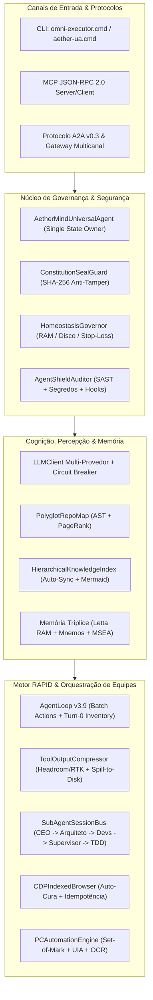

# OmniExecutor (`AetherMind Universal Agent v4.1`)

**Autonomous Coding Agent, Hierarchical Team Orchestrator, CDP Browser Engine & MCP/A2A Harness**

[](tests/)
[-2ea44f?style=flat-square)](eval/am_bench/)
[-0969da?style=flat-square)](src/am_ua/security/agent_shield.py)
[](src/am_ua/execution/subagent_bus.py)
[](pyproject.toml)

> **Idioma / Language:** [Português (Brasil)](#-visão-geral-português) · [Fundamentos Matemáticos](#-fundamentos-matemáticos-e-aplicação-em-outros-projetos) · [Manual Didático de Uso](#-manual-didático-de-instruções-passo-a-passo) · [English Overview](#-english-overview--quick-reference)

---

## Visão Geral (Português)

Quem trabalha com engenharia de software em produção sabe onde os agentes comuns falham: eles tentam adivinhar o conteúdo de arquivos sem ler, reescrevem módulos inteiros destruindo código adjacente, perdem o estado dinâmico de páginas web ao recarregar URLs, estouram a janela de contexto com logs inúteis e dizem que uma tarefa "funcionou" sem rodar um único teste real.

O **OmniExecutor** (`AetherMind Universal Agent`) foi construído do zero para resolver esses problemas com rigor de sistemas distribuídos. Em vez de depender de um único loop de prompt frágil, ele opera sobre um **motor de execução durável em SQLite WAL**, governado por contratos formais, poda dinâmica de contexto, validação estática via árvore sintática (AST) e orquestração hierárquica de equipes (**CEO → Arquiteto → Engenheiros → Supervisor → Auditores TDD/SAST**).

### O Que o Projeto Faz na Prática

1. **Engenharia de Código Cirúrgica (`AgentLoop` + `RAPID v3.9`):**
   - Injeta automaticamente o inventário do projeto e o mapa de símbolos (`RepoMap` via PageRank) já no **Turno 0**, eliminando chamadas cegas de `list_dir`.
   - Executa até **6 ferramentas independentes em um único turno** (`actions` em lote), reduzindo em **42,6%** a latência de parede e em **38,7%** o consumo de tokens.
   - Valida cada edição Python via AST antes e depois da escrita (`DeterministicHookEngine`), detectando erros de sintaxe, nomes não definidos e vazamento de chaves de API antes mesmo de chamar o `pytest`.
2. **Orquestração Hierárquica de Equipes (`SubAgentSessionBus`):**
   - Avalia automaticamente a severidade da missão (`0..10`) e decide se trabalha sozinho (**Modo Solo**), se monta um **Dev Squad de 4 agentes** ou se escala uma **Frota Executiva de 9 a 16 agentes em 4 ondas topológicas** (`product_ceo`, `systems_architect`, `general_engineer`, `build_error_resolver`, `performance_sre`, `eng_supervisor`, `security_auditor`, `tdd_enforcer`, `strict_auditor`).
   - Escala o número de trabalhadores paralelos (`2` a `8` threads simultâneas) medindo em tempo real a memória RAM livre do sistema operacional.
3. **Automação Web Determinística com Auto-Cura (`CDPIndexedBrowser`):**
   - Controla o Chromium via Playwright/CDP indexando elementos interativos como `[1..N]`.
   - Se um seletor CSS mudar ou quebrar, recupera o elemento automaticamente por similaridade semântica de texto, `id`, `name` ou `placeholder`.
   - Mantém **idempotência de navegação**: observar a mesma URL nunca recarrega a página acidentalmente, preservando estados de formulários e SPAs.
4. **Automação Desktop Win32 Fechada (`PCAutomationEngine`):**
   - Opera janelas nativas do Windows combinando **Set-of-Mark (SoM)** visual, árvore de acessibilidade UIA e OCR antes de qualquer clique ou atalho de teclado, protegido por trava de exclusão mútua (`GUIExclusiveLock`).
5. **Interoperabilidade Universal (`MCP` + `A2A v0.3` + `OpenClaw Gateway` + `CLI-Anything`):**
   - Atua como servidor e cliente **MCP (Model Context Protocol)** via JSON-RPC 2.0.
   - Expõe o protocolo **Agent2Agent (A2A v0.3)** (`agent/card`, `tasks/send`, `tasks/get`, `tasks/cancel`) e normaliza eventos vindos de WhatsApp, Discord, Telegram, Slack, Teams ou Webhooks.
   - Transforma qualquer utilitário de linha de comando instalado na máquina em uma skill estruturada com saída JSON e documentação `SKILL.md` (`wrap_cli_tool`).

---

## Arquitetura do Sistema



---

## Fundamentos Matemáticos e Aplicação em Outros Projetos

Os modelos matemáticos implementados no código do **OmniExecutor** foram desenhados de forma desacoplada para que você possa reutilizá-los em outros sistemas (compiladores, microsserviços financeiros, plataformas de observabilidade, recomendadores ou motores de jogos). Para detalhes extras de implementação, consulte também o [Manual de Engenharia e Fundamentos Matemáticos](docs/MANUAL_ENGENHARIA_E_FUNDAMENTOS_MATEMATICOS.md).

### 1. Calibração Epistêmica pelo Escore de Brier (`src/am_ua/contracts/calibration.py`)

Todo agente ou modelo preditivo sofre de excesso de confiança. Para medir se a confiança declarada $p_i \in [0, 1]$ corresponde à realidade empírica $o_i \in \{0, 1\}$ (onde $1$ significa que os testes reais passaram e $0$ que falharam), utilizamos o **Brier Score** acumulado por domínio:

$$\text{BS} = \frac{1}{N} \sum_{i=1}^{N} (p_i - o_i)^2$$

A autonomia efetiva permitida ao sistema é ajustada dinamicamente penalizando desvios de calibração:

$$\text{Autonomia}_{\text{efetiva}} = \text{clip}\left(\text{Autonomia}_{\text{base}} \cdot (1 - \gamma \cdot \text{BS}),\; 0.1,\; 1.0\right)$$

- **Onde aplicar em outros projetos:**
  - **Sistemas de Crédito e Antifraude (FinTech):** ponderar automaticamente se uma transação pode ser aprovada sem revisão humana quando o modelo mantém $\text{BS} < 0.08$ nas últimas 500 decisões.
  - **Pipelines de Deploy Contínuo (CI/CD):** exigir aprovação manual de PRs sempre que o índice de calibração do gerador de código cair em determinado microsserviço.

### 2. Centralidade PageRank sobre Grafo AST de Dependências (`src/am_ua/perception/polyglot_repomap.py`)

Em repositórios grandes, enviar todos os arquivos para o LLM é inviável, e a busca vetorial comum (embeddings) perde a relação estrutural de quem importa ou chama quem. Construímos um grafo direcionado $G = (V, E)$ extraindo definições e referências via AST e calculamos a importância estrutural de cada arquivo $u \in V$:

$$PR(u) = \frac{1 - d}{|V|} + d \sum_{v \in B_u} \frac{PR(v)}{L(v)}$$

onde $d = 0.85$ é o fator de amortecimento, $B_u$ é o conjunto de módulos que dependem de $u$ e $L(v)$ é o grau de saída de $v$.

- **Onde aplicar em outros projetos:**
  - **Análise de Impacto em Monorepos:** identificar os 5% de arquivos centrais cujo *refactor* exige bateria completa de testes de integração.
  - **Priorização de Auditoria de Segurança:** auditar primeiro os módulos com maior $PR(u)$ expostos a entrada externa.

### 3. Potencial de Repulsão de Casimir e Escalonamento Adaptativo de Workers (`src/am_ua/governance/homeostasis.py` & `subagent_bus.py`)

Para evitar que múltiplos agentes ou processos estourem a memória física da máquina hospedeira, modelamos uma força repulsiva de barreira inspirada no efeito Casimir conforme o recurso livre $r$ (RAM ou espaço em disco) se aproxima do piso crítico $r_{\min}$:

$$F_{\text{casimir}}(r) = \frac{\alpha}{\max(\epsilon,\; r - r_{\min})^4}$$

Em paralelo, o teto de trabalhadores simultâneos $W_{\max}$ na orquestração de equipes é determinado em tempo real pela função degrau de segurança:

$$W_{\max} = \min\left(8,\; \max\left(2,\; 2 + \left\lfloor \frac{\text{RAM}_{\text{livre\_MB}} - 2560}{1536} \right\rfloor\right)\right)$$

- **Onde aplicar em outros projetos:**
  - **Consumidores de Filas (RabbitMQ / Kafka / Celery):** ajustar o *pool* de threads ou processos dinamicamente sem sofrer *OOM-Kill* do kernel.
  - **Servidores de Inferência Local (Ollama / vLLM / ONNX):** reduzir o *batch size* antes que a paginação em disco degrade a latência P99.

### 4. Seleção Evolutiva via UCB1 e Fronteira de Pareto (`src/am_ua/evolution/constitutional_evolver.py`)

Quando o sistema busca otimizar código ou hiperparâmetros em loop fechado (estilo *Autoresearch*), ele equilibra explotação (usar a melhor variante conhecida) e exploração (testar novas mutações) através do limite superior de confiança **UCB1**:

$$\text{UCB1}_i = \bar{x}_i + c \sqrt{\frac{\ln N}{n_i}}$$

onde $\bar{x}_i$ é a recompensa média da variante $i$, $n_i$ é o número de avaliações da variante $i$, $N = \sum n_j$ é o total de rodadas e $c = \sqrt{2}$. Uma candidata $A$ só é promovida sobre a linha de base $B$ se satisfizer a **dominância estrita de Pareto** no vetor de métricas $\mathbf{m} = (\text{taxa\_acerto}, -\text{latência}, -\text{tokens}, -\text{risco})$:

$$\forall k:\; m_k(A) \ge m_k(B) \quad \land \quad \exists k:\; m_k(A) > m_k(B)$$

- **Onde aplicar em outros projetos:**
  - **Testes A/B e Otimização de Conversão:** substituir algoritmos estáticos por *Multi-Armed Bandits* que convergem rápido sem desperdiçar tráfego em variantes ruins.
  - **Otimização de Queries SQL e Compiladores:** aceitar automaticamente reescritas de queries apenas quando melhoram o tempo de execução sem aumentar o uso de memória ou alterar a cardinalidade do resultado.

### 5. Curva de Retenção Bi-Temporal FSRS / ACT-R (`src/am_ua/memory/mnemos_connector.py`)

Para decidir quais memórias técnicas de longo prazo devem ser injetadas no prompt e quais devem decair ou ser consolidadas, combinamos a ativação de base **ACT-R** com a curva de esquecimento **FSRS** em função do tempo decorrido $t$ e da estabilidade $S$:

$$R(t, S) = \left(1 + \kappa \cdot \frac{t}{S}\right)^{-\beta}, \qquad A_i = \ln \left(\sum_{j=1}^{m} t_j^{-d}\right) + \sum_{k} w_k S_{ki}$$

- **Onde aplicar em outros projetos:**
  - **Sistemas de Recomendação e Assistentes Corporativos:** priorizar documentos e decisões arquiteturais recentes e frequentemente validados, evitando poluir o contexto com regras obsoletas.
  - **Plataformas de Educação e Treinamento Adaptativo:** agendar revisões exatamente no ponto onde a probabilidade de retenção $R(t, S)$ atinge $0.90$.

---

## Manual Didático de Instruções (Passo a Passo)

### 1. Pré-requisitos e Instalação Rápida

1. **Python 3.11+** instalado no sistema.
2. Clone o repositório e instale as dependências em modo editável:

```powershell
git clone https://github.com/juan3861/omni-executor.git
cd omni-executor
pip install -e .
```

3. Configure pelo menos uma chave de provedor LLM no ambiente (o cliente faz *failover* automático entre provedores locais e em nuvem):

```powershell
$env:GROQ_API_KEY="sua-chave-groq"
$env:OPENROUTER_API_KEY="sua-chave-openrouter"
# Opcional: $env:OPENAI_API_KEY="sua-chave-openai"
```

---

### 2. Comandos Principais de Terminal (`omni-executor.cmd`)

| Objetivo | Comando | O Que Ele Faz |
| :--- | :--- | :--- |
| **Diagnóstico Completo** | `.\omni-executor.cmd doctor` | Verifica integridade do banco SQLite WAL, RAM livre, espaço em disco, selo SHA-256 e disponibilidade dos 16 módulos nucleares. |
| **Auditoria de Segurança (SAST)** | `.\omni-executor.cmd shield .` | Escaneia o repositório em busca de segredos expostos, configurações MCP inseguras e padrões vulneráveis (`pickle`, `yaml.load`, `shell=True`), gerando nota de `A` a `F`. |
| **Executar Missão de Engenharia** | `.\omni-executor.cmd agent "Corrija o bug de arredondamento em money.py" --workspace .\meu_app --verify "pytest -q"` | Executa o loop autônomo no diretório indicado e só encerra quando o comando `--verify` retornar código `0`. |
| **Servidor MCP Nativo** | `.\omni-executor.cmd mcp-serve` | Inicia o servidor Model Context Protocol via `stdio` (JSON-RPC 2.0) para integração com Claude Code, Cursor, Codex ou Antigravity. |
| **Status do Roadmap Selado** | `.\aether-compass.cmd status` | Exibe o estado criptográfico das 27 subfases arquiteturais e verifica se houve desvio (*drift*) em arquivos críticos. |

---

### 3. Como Usar em Diferentes Tipos de Projetos e Processos

#### Caso A: Desenvolvimento e Refatoração de Projetos Existentes (Python, Node, Rust, Go)
Use o `AetherMindUniversalAgent` via Python ou CLI apontando para a pasta do seu projeto e fornecendo o comando de teste da sua stack (`pytest`, `npm test`, `cargo test`, `go test ./...`):

```python
from am_ua.agent_kernel import AetherMindUniversalAgent

agent = AetherMindUniversalAgent()
resultado = agent.run_agent_mission(
    objective="Renomeie calc_total para compute_total em todos os módulos e atualize os imports",
    workspace="C:/projetos/meu_servico",
    verify_cmd="pytest -q",
    workflow="hierarchical",
    adaptive_best_of_n=2,
)
print(resultado["status"], resultado["changed_files"])
```

#### Caso B: Criação e Gerenciamento de uma Equipe Completa de Devs (`CEO → Arquiteto → Devs → Supervisor`)
Quando você tem um projeto complexo ou de programação severa e quer que uma equipe estruturada planeje a arquitetura, implemente em paralelo, supervisione os diffs e audite os testes:

```python
from am_ua.execution.subagent_bus import SubAgentSessionBus

bus = SubAgentSessionBus()

# 1. Inspecionar como o cérebro classifica a missão e quem assumirá cada cargo:
plano = bus.assess_team_topology(
    "Arquitetura severa full-stack com API backend, dashboard web, auditoria de segurança SAST e bateria TDD",
    workspace_file_count=18,
)
print("Modo selecionado:", plano["mode"])          # executive_enterprise_fleet
print("Hierarquia:", plano["hierarchy"])           # CEO: product_ceo | Arquiteto: systems_architect | Supervisor: eng_supervisor

# 2. Disparar as 4 ondas completas (CEO + Arquiteto -> Devs/SRE -> Supervisor/Security -> TDD/Auditor):
relatorio = bus.orchestrate_team(
    "Implementar módulo de autenticação JWT com proteção anti-replay e testes de borda",
    workspace_file_count=18,
)
print(f"Agentes acionados: {relatorio['total_agents_spawned']} em {relatorio['waves_executed']} ondas")
```

#### Caso C: Indexação de Repositórios e Geração Automática de Diagramas de Arquitetura
Para mapear rapidamente um repositório desconhecido (código Python, schemas `.sql`, configurações `.json`/`.yaml` e docs `.md`) e gerar um diagrama Mermaid das dependências reais:

```python
from am_ua.perception.knowledge_index import HierarchicalKnowledgeIndex

idx = HierarchicalKnowledgeIndex("C:/projetos/meu_monorepo")

# Busca estrutural sem precisar de banco vetorial externo:
res = idx.query("tabela de sessões e autenticação")
print(res["hits"])

# Sincronização incremental instantânea após editar arquivos:
delta = idx.sync_changes()
print("Arquivos atualizados:", delta["updated"])

# Exportar diagrama Mermaid pronto para colocar na documentação:
print(idx.export_mermaid_graph())
```

#### Caso D: Transformar Qualquer Programa ou Script em Ferramenta Nativa de Agente (`CLI-Anything`)
Se você tem uma ferramenta interna de linha de comando (por exemplo, `git`, `docker`, `ffmpeg` ou um script da sua empresa) e quer que o agente a utilize com saída JSON validada por AST:

```python
import sys
from am_ua.execution.adaptive_skills import AdaptiveSkillForge

forge = AdaptiveSkillForge()
skill = forge.wrap_cli_tool(sys.executable, skill_name="cli_python_diag", help_args=["--help"])
print("Manual gerado em:", skill["skill_md_path"])

execucao = forge.run_skill("cli_python_diag", {"argv": ["-c", "import json; print(json.dumps({'ok': True}))"]})
print("JSON parseado:", execucao["result"]["parsed_json"])
```

#### Caso E: Automação Web Resiliente e Testes E2E (`CDPIndexedBrowser`)
Para extrair dados ou testar aplicações web dinâmicas sem quebrar quando um botão muda de classe CSS:

```python
from am_ua.gui.cdp_browser import CDPIndexedBrowser

browser = CDPIndexedBrowser(headless=True)
obs = browser.observe("https://exemplo.local/login")
browser.act("fill", target="#usuario", text="admin")
browser.act("click", target="Confirmar Acesso")  # Auto-cura por texto se o ID não existir
dados = browser.extract("#painel_status")
browser.close()
```

---

## Resultados Empíricos e Benchmarks (`AM-Bench`)

Todos os testes abaixo foram executados contra provedores de LLM reais (zero mocks no benchmark) sob fiscalização do `ConstitutionSealGuard`:

| Bateria / Métrica | Resultado Verificado | Arquivo de Prova no Repositório |
| :--- | :--- | :--- |
| **AM-Bench Código (15 Cenários Python)** | **15 / 15 aprovados (`100.0%`)** | [am_bench_v39_rapid_full20_20261117_011748.json](.proof/am_bench_v39_rapid_full20_20261117_011748.json) |
| **AM-Bench Browser/CDP (5 Cenários Web)** | **5 / 5 aprovados (`100.0%`)** | [am_bench_v39_browser_all5_20261117_161109.json](.proof/am_bench_v39_browser_all5_20261117_161109.json) |
| **Redução de Latência (Motor RAPID v3.9)** | **-42,6% no tempo total** (`2.323s` → `1.334s`) | [output_compressor.py](src/am_ua/execution/output_compressor.py) |
| **Economia de Tokens (Motor RAPID v3.9)** | **-38,7% de tokens** (`1,78M` → `1,09M` tokens) | [agent_loop.py](src/am_ua/execution/agent_loop.py) |
| **Paridade contra Top-100 + 12 Pioneiros do GitHub** | **16 / 16 eixos AST verificados (`100.0%`)** | [top100_github_parity_audit.json](.proof/top100_github_parity_audit.json) |
| **Suíte de Testes Unitários e de Integração** | **73 / 73 aprovados (`100.0%`)** | [tests/](tests/) |
| **Auditoria Estática de Segurança (`AgentShield`)** | **Grau A (`risk_score: 0` em 63 arquivos)** | [agent_shield.py](src/am_ua/security/agent_shield.py) |

---

## Mapa de Diretórios do Projeto

```text
omni-executor/
├── omni-executor.cmd              # Atalho principal da CLI (Windows)
├── aether-ua.cmd                  # CLI do kernel AetherMind Universal Agent
├── aether-compass.cmd             # Verificador criptográfico de fases (Project Compass)
├── constitution/                  # Regras constitucionais imutáveis e manifesto SHA-256
├── docs/                          # Documentação técnica e manual matemático detalhado
├── eval/
│   ├── am_bench/                  # Benchmark selado de 25 tarefas (Código, Browser, Desktop)
│   ├── audit_top100_github.py     # Auditor AST de paridade contra Top-100 + 12 repos de nicho
│   └── test_empirical_v34_ceiling.py
├── src/am_ua/
│   ├── agent_kernel.py            # Fachada unificada e telemetria OpenTelemetry
│   ├── cognition/                 # LLMClient, Planner DAG, Personas, SONA, ReasoningBank, URE
│   ├── contracts/                 # Envelopes cognitivos, taint R16 e Calibração de Brier
│   ├── evolution/                 # Evolução constitucional UCB1 / MAP-Elites Pareto
│   ├── execution/                 # AgentLoop RAPID, DurableEngine, SubAgentSessionBus (A2A/Squads)
│   ├── governance/                # HomeostasisGovernor, SealGuard SHA-256, Alpha-C13
│   ├── gui/                       # CDPIndexedBrowser e VerifiedBrowserAdapter
│   ├── memory/                    # TriadMemoryProvider (Letta Core + Mnemos + MSEA)
│   ├── perception/                # PolyglotRepoMap (PageRank) e HierarchicalKnowledgeIndex
│   ├── routing/                   # UniversalCognitiveRouter (OmniRoute / RTK)
│   └── security/                  # AgentShieldAuditor (SAST) e envelope Windows DPAPI
└── tests/                         # 73 testes automatizados (unitários, caos e estresse de equipe)
```

---

## English Overview & Quick Reference

**OmniExecutor** (`AetherMind Universal Agent v4.1`) is a production-grade autonomous software engineering harness, hierarchical multi-agent orchestrator, and verified browser/desktop automation engine written in Python.

### Key Engineering Capabilities
- **Surgical Code Execution (`RAPID v3.9`):** Pre-seeds Turn-0 workspace file inventories and AST PageRank symbol maps (`PolyglotRepoMap`), batches up to 6 independent tool calls per turn, compresses noisy tool outputs with automatic spill-to-disk recovery (`ToolOutputCompressor`), and enforces pre/post-write AST & secret hooks (`DeterministicHookEngine`).
- **Executive & Dev Squad Governance (`SubAgentSessionBus`):** Dynamically evaluates mission severity (`0..10`) to scale from a single specialist up to a 4-wave **Executive Enterprise Fleet** (`product_ceo` → `systems_architect` → parallel `general_engineer` / `build_error_resolver` / `performance_sre` → `eng_supervisor` / `security_auditor` → `tdd_enforcer` / `strict_auditor`), scaling worker concurrency (`2..8` threads) from live host RAM.
- **Open Interoperability (`MCP` + `A2A v0.3` + `OpenClaw Gateway`):** Native stdio MCP server (`omni-executor.cmd mcp-serve`), Agent2Agent (A2A v0.3) JSON-RPC 2.0 endpoint (`agent/card`, `tasks/send`, `tasks/get`, `tasks/cancel`), and unified channel event ingestion.
- **Self-Healing Browser & Closed-Loop Desktop RPA:** Indexed DOM `[1..N]` Playwright/CDP browser with selector self-healing and same-URL navigation idempotence, paired with Set-of-Mark + UIA + OCR Windows desktop automation.
