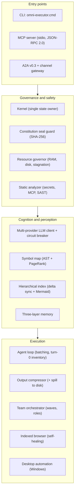

# OmniExecutor Agent

**An autonomous coding agent with a hierarchical team orchestrator, a self-healing browser engine and an MCP / A2A harness — built around durable execution, verifiable results and strict safety gates.**

[](tests/)
[-2ea44f?style=flat-square)](#benchmarks-and-honest-caveats)
[](src/am_ua/security/agent_shield.py)
[](src/am_ua/execution/subagent_bus.py)
[](pyproject.toml)

**Contents:** [Why](#why-this-project-exists) · [What it does](#what-it-does) · [Architecture](#architecture) · [Quick start](#quick-start) · [CLI reference](#cli-reference) · [Python recipes](#python-recipes) · [Team orchestration](#team-orchestration-how-and-when-agents-are-created) · [Mathematical foundations](#mathematical-foundations) · [Benchmarks and caveats](#benchmarks-and-honest-caveats) · [Limitations](#known-limitations) · [Repository layout](#repository-layout)

---

## Why this project exists

Most coding agents fail in the same predictable ways: they edit files they never read, rewrite whole modules to change one line, flood the context window with log noise, lose page state by reloading a URL they already had open, and report "done" without running a single test.

OmniExecutor Agent treats those failures as engineering problems:

- **Results are verified, not declared.** A mission is marked `VERIFIED` only if your acceptance command (for example `pytest -q`) exits with code `0`.
- **Execution is durable.** Every tool call is routed through an SQLite-WAL execution engine with an effect taxonomy and lease fencing, so retries cannot silently double-apply a side effect.
- **Context is budgeted.** A workspace inventory is injected on turn 0, tool outputs are compressed (with the full output spilled to disk), and the prompt only advertises tools relevant to the task.
- **Safety is enforced in code.** Writes are checked against a sealed constitution (SHA-256 manifest), a static analyzer scans for secrets and unsafe patterns, and a resource governor stops runaway cost.

## What it does

| Area | Capability | Main module |
| :--- | :--- | :--- |
| **Coding loop** | Turn-0 workspace inventory, up to 6 tool calls batched per turn (`actions`), surgical `replace_in_file`, checkpoint/restore, AST pre/post-write hooks, adaptive best-of-N escalation with a failure post-mortem | `execution/agent_loop.py` |
| **Team orchestration** | Severity-scored topology: solo agent, 4-agent dev squad, or 9-agent executive fleet in 4 dependency waves; RAM-aware parallelism | `execution/subagent_bus.py` |
| **Code intelligence** | Cross-language symbol map ranked with PageRank; vectorless hierarchical index over `.md/.sql/.json/.yaml/.py` with incremental SHA-256 delta sync and Mermaid export | `perception/` |
| **Browser** | Playwright/CDP with `[1..N]` indexed DOM, selector self-healing, same-URL navigation idempotence, lightweight `web_fetch` | `gui/cdp_browser.py` |
| **Desktop (Windows)** | Set-of-Mark grounding + UI Automation + OCR before any click or keystroke, with a global GUI lock | `execution/pc_automation.py` |
| **Interoperability** | MCP server/client (JSON-RPC 2.0 over stdio), A2A v0.3 agent card and task methods, multi-channel event ingestion, CLI-to-skill wrapper | `execution/mcp_federation.py`, `execution/subagent_bus.py`, `execution/adaptive_skills.py` |
| **Safety** | Constitution seal guard, static analyzer (secrets, MCP config, hooks, unsafe code patterns), Windows DPAPI envelopes, resource governor | `governance/`, `security/` |
| **Memory and learning** | Three-layer memory, trajectory replay, pitfall warnings, Brier-score calibration, UCB1 + Pareto-gated self-evolution | `memory/`, `cognition/`, `evolution/` |

## Architecture



## Quick start

> **Platform note.** The project is currently **Windows-first** (UI Automation, DPAPI, PowerShell acceptance commands) and expects a writable *safe temp root* configured in `constitution/IMMUTABLE_CONSTITUTION.json` (`safe_temp_root`). See [Known limitations](#known-limitations).

```powershell
git clone https://github.com/juan3861/omni-executor.git
cd omni-executor
pip install -e .

# Optional extras, only for the features that use them:
pip install playwright pytesseract pillow numpy uiautomation
playwright install chromium
```

Configure at least one LLM provider. The client tries providers in order and fails over automatically:

```powershell
$env:GROQ_API_KEY       = "<your-key>"
$env:OPENROUTER_API_KEY = "<your-key>"
# optional: $env:OPENAI_API_KEY = "<your-key>"
# optional: $env:AM_UA_PROVIDERS = "groq,openrouter,openai"   # provider order
```

Sanity checks:

```powershell
.\omni-executor.cmd doctor     # readiness: database, seal, resources, organs
.\omni-executor.cmd shield .   # static analysis of the current directory
pytest tests -q                # 73 tests
```

## CLI reference

All commands run through `omni-executor.cmd` (`.\omni-executor.cmd <command> ...`).

| Command | Purpose |
| :--- | :--- |
| `doctor` | Full readiness check (state owner, seal, topology, memory, resource headroom). |
| `shield <dir>` | Static analysis: secrets, unsafe MCP configs, risky hooks, unsafe code patterns. Prints a grade `A`–`F`. |
| `mission "<objective>" --workspace <dir> --verify "<cmd>"` | Run the autonomous agent. Marked `VERIFIED` only if `<cmd>` exits `0`. Useful flags: `--workflow react\|sparc\|hierarchical`, `--best-of-n N`, `--role <persona>`, `--max-turns N`. |
| `repomap <dir>` | Build the PageRank-ranked symbol map. |
| `browser observe\|act\|extract --url <url>` | Drive the indexed browser (`--index`, `--selector`, `--act-type`). |
| `pc probe\|windows\|observe\|find\|clipboard\|processes\|port` | Windows desktop automation primitives. |
| `skills list\|search\|run` | Manage self-forged, AST-validated, hash-sealed Python skills. |
| `mcp-serve` | Start the MCP server over stdio for MCP-capable clients. |
| `bench run\|report` | Run or summarize the bundled benchmark. |

Example:

```powershell
.\omni-executor.cmd mission "Fix the rounding bug in money.py" `
    --workspace .\sandbox\my_app `
    --verify "python -m pytest -q" `
    --workflow hierarchical --best-of-n 2
```

`--workspace` must resolve **inside the project directory or the configured safe temp root** (see limitations).

## Python recipes

### 1. Run a verified engineering mission

```python
from am_ua import OmniExecutorAgent

agent = OmniExecutorAgent()
result = agent.run_agent_mission(
    "Rename calc_total to compute_total in every module and fix the imports",
    workspace="sandbox/my_app",          # inside the project directory
    verify_cmd="python -m pytest -q",    # exit code 0 == VERIFIED
    workflow="hierarchical",
    adaptive_best_of_n=2,                # escalate with a failure post-mortem if the first try fails
)
print(result["status"], result["turns"], result["changed_files"])
```

### 2. Let the orchestrator decide how big a team the task needs

```python
from am_ua.execution.subagent_bus import SubAgentSessionBus

bus = SubAgentSessionBus()
plan = bus.assess_team_topology(
    "Severe enterprise refactor: backend API, web dashboard, security audit, latency work, TDD",
    workspace_file_count=18,
)
print(plan["mode"], plan["severity_score"], plan["hierarchy"])

report = bus.orchestrate_team("Implement JWT auth with replay protection and edge-case tests",
                              workspace_file_count=18)
print(report["total_agents_spawned"], "agents in", report["waves_executed"], "waves")
```

> Without a custom `worker_fn`, `orchestrate_team` uses a stub worker that only records the role objective. Pass your own `worker_fn(session_id, objective, workspace)` to run real agents.

### 3. Index a repository and export an architecture diagram

```python
from am_ua.perception.knowledge_index import HierarchicalKnowledgeIndex

idx = HierarchicalKnowledgeIndex("path/to/repo")
print(idx.query("session table and authentication")["hits"])
print(idx.sync_changes())           # incremental re-index after edits (SHA-256 delta)
print(idx.export_mermaid_graph())   # paste into any Markdown file
```

### 4. Turn any CLI tool into a structured agent skill

```python
import sys
from am_ua.execution.adaptive_skills import AdaptiveSkillForge

forge = AdaptiveSkillForge()
skill = forge.wrap_cli_tool(sys.executable, skill_name="cli_python_diag")
out = forge.run_skill("cli_python_diag",
                      {"argv": ["-c", "import json; print(json.dumps({'ok': True}))"]})
print(out["result"]["parsed_json"])   # {'ok': True}
```

### 5. Resilient browser automation

```python
from am_ua.gui.cdp_browser import CDPIndexedBrowser

browser = CDPIndexedBrowser(headless=True)
browser.observe("https://example.com/login")
browser.act("fill", target="#username", text="admin")
browser.act("click", target="Sign in")      # falls back to text/semantic match if the selector breaks
print(browser.extract("#status"))
browser.close()
```

## Team orchestration: how and when agents are created

The orchestrator scores each mission from `0` to `10`, then picks a topology.

| Score | Mode | Agents | Roles (waves) |
| :--- | :--- | :---: | :--- |
| `0–2` | Solo specialist | 1 | `general_engineer` |
| `3–5` | Dev squad | 4 | `systems_architect` → `general_engineer` → `eng_supervisor` + `tdd_enforcer` |
| `6–10` | Executive fleet | 9 | `product_ceo` + `systems_architect` → `general_engineer` + `build_error_resolver` + `performance_sre` → `eng_supervisor` + `security_auditor` → `tdd_enforcer` + `strict_auditor` |

**Limits (all in `subagent_bus.py`):** parallel workers adapt to free RAM between `2` and `8`; at most `16` agents per mission; spawn depth is capped at `2`; only one agent may hold the physical mouse and keyboard at a time. These are deliberate guard rails — an unbounded agent count would be a fork-bomb risk.

Each wave receives a brief of the previous wave's summaries through the message bus, so the architect's contracts reach the implementers and the supervisor sees what was built.

## Mathematical foundations

Formulas below match the implementation. Full derivations, constants and ways to reuse each idea in other systems are in the **[Engineering and Mathematics Manual](docs/ENGINEERING_AND_MATH_MANUAL.md)**.

**Calibration (Brier score).** For predicted success probability $p_i$ and observed outcome $y_i \in \{0,1\}$ (the acceptance command's result):

```math
\mathrm{BS} = \frac{1}{N}\sum_{i=1}^{N}\left(p_i - y_i\right)^2
```

**Code centrality (PageRank, damping $d=0.85$).** For a symbol-reference graph with $n$ files and edge weights $w_{vu}$:

```math
PR(u) = \frac{1-d}{n} + d\sum_{v \to u} PR(v)\,\frac{w_{vu}}{\sum_{z} w_{vz}}
```

**Worker scaling from free RAM.**

```math
W = \min\!\left(8,\ \max\!\left(2,\ 2 + \left\lfloor \frac{\mathrm{RAM}_{\mathrm{free}}[\mathrm{MB}] - 2560}{1536} \right\rfloor\right)\right)
```

**Storage-pressure signal (Casimir-style).** With normalized free gap $d = \mathrm{free}/\mathrm{total}$:

```math
F_c(d) = -\frac{\pi^2}{240\, d^{4}}
```

**Evolution parent selection (UCB1, $c = 1.414$).**

```math
\mathrm{UCB}_i = \bar{x}_i + c\sqrt{\frac{\ln(N+1)}{n_i}}
```

## Benchmarks and honest caveats

The repository ships its own sealed benchmark (`eval/am_bench/`, "AM-Bench"): tasks run against real LLM providers; a task passes only if hidden tests pass **and** the visible tests are byte-identical (anti-tamper).

| Run | Result | Evidence |
| :--- | :--- | :--- |
| Code tasks (15) | 15 / 15 passed | [`am_bench_v39_rapid_full20_20261117_011748.json`](.proof/am_bench_v39_rapid_full20_20261117_011748.json) |
| Browser tasks (5) | 5 / 5 passed (re-run after a navigation fix) | [`am_bench_v39_browser_all5_20261117_161109.json`](.proof/am_bench_v39_browser_all5_20261117_161109.json) |
| Unit and integration tests | 73 passed | [`tests/`](tests/) |
| Static analysis of this repo | grade A, 0 findings | `omni-executor.cmd shield .` |

Please read these numbers with care:

- It is a **small, self-authored, self-reported benchmark** (20 tasks), not an independent leaderboard result.
- The first full 20-task run had 19/20 passing; the 5/5 browser result comes from a **separate re-run after fixing the failing case**.
- The efficiency gain reported during development (about -38.7 % tokens, -42.6 % wall time) compares **two single runs on free-tier providers on different days**; treat it as indicative, not as a controlled measurement.
- Several browser tasks finish with status `COMPLETED_UNVERIFIED` (no in-loop acceptance command); the pass/fail verdict comes from the benchmark's hidden test.
- A parity audit against popular open-source agent projects is included ([`top100_github_parity_audit.json`](.proof/top100_github_parity_audit.json)); it is a **keyword-and-file-presence check**, not a feature-by-feature quality comparison.

## Known limitations

- **Windows-first.** Desktop automation (UI Automation, OCR), DPAPI envelopes and PowerShell verification commands are Windows-specific. Browser, code and orchestration features are mostly portable but are only tested on Windows.
- **Fixed safe temp root.** Several defaults point at a drive-letter path configured as `safe_temp_root` in the constitution. Changing it means editing a sealed file and re-sealing the manifest.
- **Workspace restriction.** The seal guard only allows writes inside the project directory or the safe temp root (outside the protected `eval/` and `constitution/` zones).
- **No automatic dependency install.** `pyproject.toml` declares no dependencies; install the optional extras listed in [Quick start](#quick-start) for the features you use.
- **LLM required.** The agent needs at least one reachable provider; quality depends on the model behind it.
- **Orchestration workers.** `orchestrate_team` needs a real `worker_fn` to run real agents (the default is a recording stub).
- **Desktop benchmark tasks** need an interactive Windows session with desktop composition and are not part of the headless results above.

## Repository layout

```text
omni-executor/
├── omni-executor.cmd            # CLI entry point (Windows)
├── constitution/                # sealed rules and SHA-256 manifest
├── docs/ENGINEERING_AND_MATH_MANUAL.md
├── eval/
│   ├── am_bench/                # bundled sealed benchmark
│   └── audit_top100_github.py   # repository parity audit script
├── src/am_ua/
│   ├── agent_kernel.py          # facade and telemetry
│   ├── cognition/               # LLM client, planner, personas, memory of trajectories
│   ├── contracts/               # envelopes, taint tracking, calibration
│   ├── evolution/               # UCB1 + Pareto-gated evolution
│   ├── execution/               # agent loop, durable engine, team bus, MCP, skills
│   ├── governance/              # seal guard, resource governor
│   ├── gui/                     # indexed browser, verified adapter
│   ├── memory/                  # three-layer memory
│   ├── perception/              # symbol map, hierarchical index
│   ├── routing/                 # provider/endpoint router
│   └── security/                # static analyzer, DPAPI envelopes
└── tests/                       # 73 automated tests
```

## License

MIT (see `pyproject.toml`).
